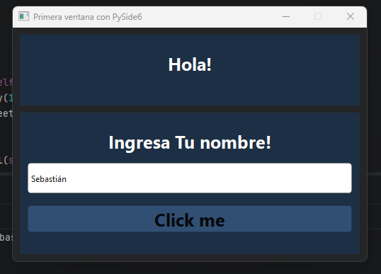
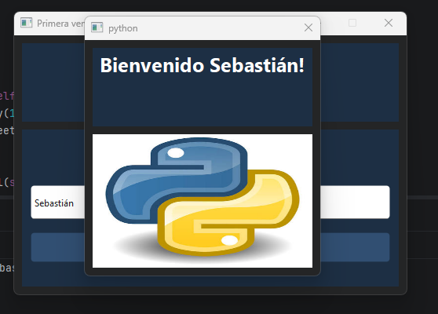

# Taller de Investigación: Interfaces Gráficas con PySide6
**Asignatura:** Programación Orientada a Objetos  
**Tema:** Interfaces gráficas y programación orientada a eventos  
**Biblioteca seleccionada:** PySide6 (Qt 6 for Python)

---

## Tabla de Contenido
1. [Investigación Teórica](#1-investigación-teórica)
   - [¿Qué es PySide6 y su propósito principal?](#11-qué-es-pyside6-y-su-propósito-principal)
   - [¿Qué tipo de aplicaciones permite desarrollar?](#12-qué-tipo-de-aplicaciones-permite-desarrollar)
   - [Instalación y Requisitos](#13-instalación-y-requisitos)
   - [Principales Componentes Gráficos](#14-principales-componentes-gráficos)
   - [Manejo de Eventos del Usuario](#15-manejo-de-eventos-del-usuario)
   - [Ventajas y Limitaciones frente a Tkinter](#16-ventajas-y-limitaciones-frente-a-tkinter)
2. [Explicación del Funcionamiento](#2-explicación-del-funcionamiento)
   - [Creación de la Ventana Principal](#21-creación-de-la-ventana-principal)
   - [Creación y Visualización de Componentes](#22-creación-y-visualización-de-componentes)
   - [Eventos Implementados y Detección](#23-eventos-implementados-y-detección)
   - [Método de Respuesta al Evento](#24-método-de-respuesta-al-evento)
   - [Modificación de la Interfaz tras la Interacción](#25-modificación-de-la-interfaz-tras-la-interacción)
3. [Código Fuente del Proyecto](#3-código-fuente-del-proyecto)
4. [Instrucciones de Ejecución](#4-instrucciones-de-ejecución)
5. [Evidencia Visual](#5-evidencia-visual)
6. [Fuentes Consultadas](#6-fuentes-consultadas)

---

## 1. Investigación Teórica

### 1.1. ¿Qué es PySide6 y su propósito principal?
**PySide6** es el conjunto oficial de enlaces (*bindings*) en Python para el framework **Qt 6**, desarrollado y mantenido por **The Qt Company**. Su propósito primordial es facilitar la construcción de aplicaciones de escritorio multiplataforma (Windows, Linux, macOS) con interfaces gráficas modernas, alto rendimiento y una arquitectura fuertemente orientada a objetos sustentada en el motor nativo de C++.

### 1.2. ¿Qué tipo de aplicaciones permite desarrollar?
* **Software empresarial y de gestión:** Paneles administrativos, herramientas de conexión a bases de datos (CRUD), puntos de venta y sistemas ERP.
* **Herramientas de ingeniería y visualización científica:** Interfaces de telemetría en tiempo real, integración con bibliotecas como Matplotlib, visores 3D y simuladores.
* **Software multimedia y herramientas de diseño:** Paneles de control para producción audiovisual y plugins para suites avanzadas como Blender, Maya y Houdini.

### 1.3. Instalación y Requisitos
* **Requisitos:**
  * Python 3.8 o superior.
  * Gestor de paquetes `pip`.
* **Instalación:**
  ```bash
  pip install PySide6
  ```

### 1.4. Principales Componentes Gráficos
Todos los componentes visuales en PySide6 heredan de la clase base `QWidget`. Los más utilizados del módulo `PySide6.QtWidgets` son:
* `QMainWindow`: Ventana principal que provee la estructura base (barra de menús, barra de estado y widget central).
* `QDialog`: Ventana secundaria o cuadro de diálogo emergente utilizado para confirmaciones o avisos.
* `QFrame`: Contenedor visual rectangular utilizado para agrupar elementos y aplicar estilos/bordes.
* `QLabel`: Despliegue de texto estático, imágenes o animaciones.
* `QLineEdit`: Campo de entrada de texto de una sola línea para formularios.
* `QPushButton`: Botón interactivo de comando para ejecutar acciones.

### 1.5. Manejo de Eventos del Usuario
PySide6 implementa el paradigma desacoplado de **Signals & Slots (Señales y Ranuras)**:
* **Signal (Señal):** Notificación emitida automáticamente por un widget cuando ocurre una acción del usuario (por ejemplo, el clic de un ratón con `QPushButton.clicked` o la pulsación de la tecla Enter con `QLineEdit.returnPressed`).
* **Slot (Ranura):** Método o función receptora encargada de procesar la lógica de negocio.
* **Conexión:** Se asocian limpiamente mediante el método `.connect()`, sin necesidad de manejar cadenas de texto arbitrarias ni alterar el paso de argumentos.

### 1.6. Ventajas y Limitaciones frente a Tkinter

| Criterio | PySide6 | Tkinter |
| :--- | :--- | :--- |
| **Estética y Personalización** | Interfaz moderna, renderizado nativo del sistema y soporte avanzado de hojas de estilo (*Qt Style Sheets* tipo CSS). | Apariencia básica y anticuada por defecto; `ttk` mejora el aspecto pero mantiene limitaciones de personalización. |
| **Arquitectura de Eventos** | *Signals & Slots* fuertemente tipados y desacoplados. | Sistema basado en cadenas de texto mágicas (`"<Return>"`, `"<Button-1>"`) con dependencia estricta del foco activo. |
| **Escalabilidad** | Robusto para proyectos grandes, soporte multinúcleo con `QThread` y herramientas avanzadas de diseño. | Adecuado para scripts sencillos; se vuelve engorroso en proyectos con múltiples vistas o hilos. |
| **Instalación** | Requiere descarga externa vía `pip` (~100 MB). | Viene preinstalado con la biblioteca estándar de Python. |
| **Curva de Aprendizaje** | Requiere comprender orientación a objetos estricta y jerarquías padre-hijo. | Curva baja para scripts procedimentales rápidos. |

---

## 2. Explicación del Funcionamiento

### 2.1. Creación de la Ventana Principal
La aplicación se encapsula en la clase `Ventana`, la cual hereda directamente de `QMainWindow`.
* Al instanciar `super().__init__()`, se configuran las dimensiones fijas (`500x330 px`) con `setFixedSize`, el título con `setWindowTitle` y el color de fondo mediante `setStyleSheet`.
* La ventana se expone al sistema operativo mediante el bucle principal administrado por `QApplication(sys.argv)` y `app.exec()`.

### 2.2. Creación y Visualización de Componentes
A diferencia de Tkinter (donde se requiere instanciar y luego invocar `.pack()` o `.grid()`), en PySide6 la pertenencia visual se define pasando el contenedor padre en el constructor:
* `self.frame_titulo = QFrame(self)` establece que el frame pertenece a la ventana principal.
* `self.titulo = QLabel(self.frame_titulo)` hace que la etiqueta resida dentro de ese frame.
* El posicionamiento y dimensionamiento exacto se determina con `setGeometry(x, y, ancho, alto)`, asegurando un diseño fijo y ordenado sin conflicto entre celdas.

### 2.3. Eventos Implementados y Detección
Se implementaron dos mecanismos complementarios de interacción orientada a eventos:
1. **Evento de ratón:** Señal `.clicked` proveniente del widget `QPushButton`.
2. **Evento de teclado:** Señal `.returnPressed` proveniente del widget `QLineEdit`.
* Ambos eventos detectan la interacción y dirigen el flujo hacia el mismo manejador, garantizando que el usuario pueda enviar el formulario haciendo clic o pulsando la tecla `Enter`.

### 2.4. Método de Respuesta al Evento
* El método `obtiene_texto(self)` actúa como el **Slot** receptor.
* Extrae el contenido ingresado en la caja de texto mediante `self.entrada.text()` y aplica la lógica necesaria para actualizar el estado.

### 2.5. Modificación de la Interfaz tras la Interacción
* Cuando se dispara `obtiene_texto(self)`, el método altera dinámicamente el texto del cuadro emergente invocando `self.titulo_dialogo.setText(...)`.
* Posteriormente, hace visible el cuadro de diálogo modal invocando `self.dialogo.show()`, mostrando el saludo personalizado junto con la imagen de bienvenida cargada mediante estilos visuales.

---

## 3. Código Fuente del Proyecto

*Puedes consultar el [código fuente aquí](./pyside6_GUI.py).

## 4. Instrucciones de Ejecución

1. **Clonar el repositorio:**
   ```bash
   git clone https://github.com/Sebas-Martinez846/Implementaci-n-de-PySide6-para-interfaces-graficas.git
   cd Implementaci-n-de-PySide6-para-interfaces-graficas
   ```

2. **Instalar dependencias requeridas:**
   ```bash
   pip install PySide6
   ```

3. **Ejecutar la aplicación:**
   ```bash
   python pyside6_GUI.py
   ```

---

## 5. Evidencia Visual

Asegúrate de tener un archivo llamado `captura.png` y tu recurso `images.jpg` en la raíz del proyecto.

### Vista de la Aplicación en Ejecución

*Primera captura de la palicación
<a id="evidencia-captura"></a>


*Segunda captura de la aplicación
<a id="evidencia-captura"></a>


---

## 6. Fuentes Consultadas
* The Qt Company. (s.f.). *Qt for Python Documentation (PySide6)*. Recuperado de: [https://doc.qt.io/qtforpython-6/](https://doc.qt.io/qtforpython-6/)
* The Qt Company. (s.f.). *Signals and Slots in PySide6*. Recuperado de: [https://doc.qt.io/qtforpython-6/tutorials/basictutorial/signals_and_slots.html](https://doc.qt.io/qtforpython-6/tutorials/basictutorial/signals_and_slots.html)
* The Qt Company. (s.f.). *Qt Style Sheets Reference*. Recuperado de: [https://doc.qt.io/qt-6/stylesheet-reference.html](https://doc.qt.io/qt-6/stylesheet-reference.html)
